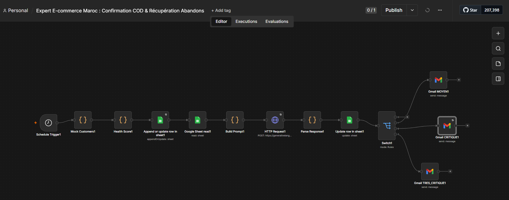
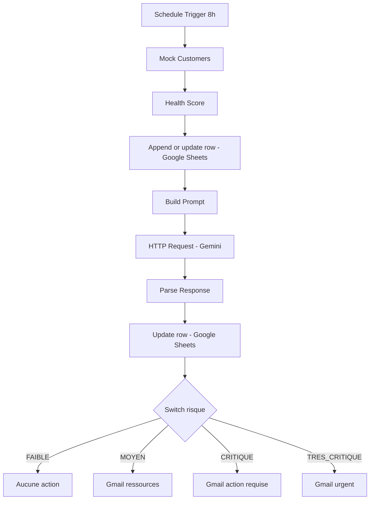

# Customer Health Score & Churn Prevention - Gemini x Sheets x Gmail

Workflow **n8n** qui surveille chaque jour la santé des clients d'un SaaS : il calcule un **health score**, demande à **Gemini** un diagnostic du risque de churn, archive le tout dans **Google Sheets** et envoie un **email adapté** au niveau de risque.

Conçu pour une équipe Customer Success qui veut repérer les comptes en danger avant qu'ils ne résilient.

## Aperçu



## Fonctionnalités

- Exécution automatique tous les jours à 8h
- Health score sur 100 points, calculé sur 5 dimensions (connexions, features, support, paiement, renouvellement)
- 4 niveaux de risque : 🟢 FAIBLE, 🟡 MOYEN, 🔴 CRITIQUE, ⚫ TRES_CRITIQUE
- Diagnostic IA : cause principale, action recommandée et brouillon d'email client
- Historique dans Google Sheets (score, risque, diagnostic)
- Email différent selon le niveau de risque
- Aucun secret dans le code

## Architecture



## Stack

| Brique | Rôle |
|---|---|
| n8n | Orchestration |
| Google Gemini | Diagnostic de churn et rédaction de l'email |
| Google Sheets | Stockage des clients et de l'historique |
| Gmail | Envoi des emails |

## Démarrage rapide

1. Importer `workflow.json` dans n8n
2. Créer le Google Sheet à partir de `data/customers_template.csv`
3. Définir `GEMINI_API_KEY` (voir `.env.example`)
4. Connecter les credentials Google Sheets et Gmail
5. Remplacer `YOUR_GOOGLE_SHEET_ID_HERE` et `YOUR_TEST_EMAIL@example.com`
6. Cliquer sur **Execute workflow** pour tester

Guide détaillé : [docs/installation.md](docs/installation.md)

## Documentation

- [Installation, configuration et tests](docs/installation.md)
- [Grille de scoring](docs/scoring.md)
- [Description de chaque nœud](docs/nodes.md)
- [Limites connues et roadmap](docs/limitations-and-roadmap.md)

## Structure du repo

```
.
├── workflow.json
├── README.md
├── .env.example
├── .gitignore
├── LICENSE
├── data/
│   └── customers_template.csv
├── docs/
│   ├── installation.md
│   ├── scoring.md
│   ├── nodes.md
│   └── limitations-and-roadmap.md
└── images/
    └── workflow.png
```

## Données de démonstration

Le workflow utilise 5 clients fictifs (nœud `Mock Customers`) qui couvrent les 4 niveaux de risque. Dans un vrai déploiement, ce nœud est remplacé par ta source de données (CRM, Stripe, base de données produit...).

## Sécurité

- Aucune clé, token ni adresse réelle dans le repo
- Les emails de test pointent vers une adresse placeholder
- Les emails sont rédigés par une IA : relis-les avant d'envoyer à de vrais clients (voir [limites](docs/limitations-and-roadmap.md))

## Auteur

Nombré Alidou Salim

## Licence

MIT
